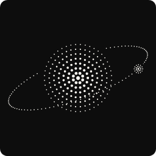

# Vulkan Sun

A work-in-progress Vulkan-based 3D simulation of the solar system, with a custom math library, dynamic arrays, camera, descriptor pools, and push constants.

## Build

```bash
cmake -B build
cmake --build build
```
